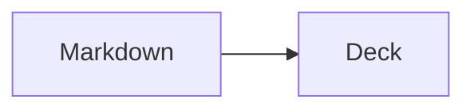

# Decko Syntax Documentation

Decko turns a Markdown file (`.svelte.md`) into a slide deck. A deck is a sequence of pages; everything else is regular Markdown plus a handful of Decko-specific extensions described below.

## Frontmatter

Deck-level metadata lives in the YAML block at the very top of the file.

| Property       | Description                                                     |
| -------------- | --------------------------------------------------------------- |
| `title`        | Deck title used for the HTML document (default `Decko`).        |
| `theme`        | Single theme name (e.g. `dracula`).                             |
| `themes`       | Theme picker list, as a comma-separated string or a YAML array. |
| `customThemes` | Map of theme name to CSS file path.                             |
| `css`          | Extra stylesheets, as a comma-separated string or a YAML array. |

Built-in themes: `default`, `claude`, `catppuccin`, `dracula`, `bubblegum`, `cyberpunk`, `forest`, `ocean`.

Any other key is kept and exported as deck data. Frontmatter values are also applied as global directives, so `paginate: true` here enables page numbers for the deck.

```yaml
---
title: My Deck
theme: dracula
themes: default, ocean
customThemes:
    brand: ./brand.css
css: ./extra.css, ./fonts.css
paginate: true
---
```

### Page Breaks

A `---` thematic break at the root level starts a new slide.

```markdown
# First page

---

# Second page
```

---

## Directives

Per-page settings are written as an HTML comment containing YAML. The comment can appear anywhere on the page.

| Directive     | Values                   | Description                                                       |
| ------------- | ------------------------ | ----------------------------------------------------------------- |
| `paginate`    | `true` / `hold` / `skip` | Show and increment / keep previous number / hide and don't count. |
| `layout`      | layout names             | See [Layouts](#layouts).                                          |
| `class`       | string                   | Classes added to the slide element.                               |
| `style`       | string                   | Inline style on the slide element.                                |
| `note`        | string                   | Speaker note stored with the page.                                |
| `step`        | number                   | Maximum step count for the page.                                  |
| `split`       | number or `"cols rows"`  | Grid columns (and rows) for the slide.                            |
| `split-gap`   | length                   | Gap between split grid cells.                                     |
| `bg`          | string                   | Shorthand background value.                                       |
| `bg-color`    | string                   | Background color.                                                 |
| `bg-image`    | string                   | Background image.                                                 |
| `bg-size`     | string                   | Background size (e.g. `cover`).                                   |
| `bg-position` | string                   | Background position (e.g. `center`).                              |
| `bg-opacity`  | string                   | Opacity of the background layer.                                  |
| `bg-filter`   | string                   | CSS filter applied to the background layer.                       |

```markdown
<!-- layout: center -->

# Centered page

<!--
layout: full center
class: wide
style: "color: #0af"
paginate: hold
-->
```

Use the `global` prefix to apply a directive to the current page and all following pages:

```markdown
<!--global paginate: true -->
```

Directive names are kebab-case (`bg-color`, not `bgColor`). Several directives can be combined in one comment, but they must be valid YAML — an invalid comment is rendered as plain text.

### Pagination

| Value  | Behaviour                                            |
| ------ | ---------------------------------------------------- |
| `true` | Shows the page number and increments it.             |
| `hold` | Shows the previous page number without incrementing. |
| `skip` | Hides the number and does not increment it.          |

---

## Layouts

| Value          | Effect                                           |
| -------------- | ------------------------------------------------ |
| `default`      | Standard padding (1.5rem).                       |
| `full`         | No padding, content can fill the page.           |
| `center`       | Centers the content.                             |
| `cover`        | Cover-style centering.                           |
| `cover-center` | Centers the content on both axes with 1.5em gap. |

Layout names are combined with spaces:

```markdown
<!-- layout: full center -->
```

`default` is matched as a prefix, and `full` removes the slide padding.

---

## Background

Background directives render a separate `.slide-background` layer behind the content.

```markdown
<!--
bg-image: url('./bg.jpg')
bg-size: cover
bg-position: center
bg-color: "#111"
bg-opacity: "0.6"
bg-filter: blur(4px)
-->
```

Or with the shorthand:

```markdown
<!-- bg: url('./bg.jpg') center / cover no-repeat -->
```

Values are applied as CSS strings, so quote anything YAML cannot read as a string (`bg-color: "#111"`). The old camelCase names (`bgImg`, `bgColor`, `bgSize`, `bgPosition`, `bgRepeat`) are no longer read.

---

## Images

```markdown

```

The `|` separates the alt text from the attributes; attributes use the same grammar as [`@{ ... }`](#attributes).

```markdown


```

| Attribute    | Description                                  |
| ------------ | -------------------------------------------- |
| `w`          | Width, applied as a style (e.g. `w=500px`).  |
| `h`          | Height, applied as a style (e.g. `h=300px`). |
| `alt`        | Overrides the alt text.                      |
| `title`      | Sets the image title.                        |
| `.class`     | Adds one or more classes.                    |
| `#id`        | Sets the element id.                         |
| `fill`       | Applies `object-fit: fill`.                  |
| `contain`    | Applies `object-fit: contain`.               |
| `cover`      | Applies `object-fit: cover`.                 |
| `scale-down` | Applies `object-fit: scale-down`.            |

Only the first matching object-fit flag is applied (checked in the order above).

### Filters

Filters are attributes whose value becomes the filter argument. A bare flag is a boolean and is ignored, so either pass a value or an empty string to use the default.

```markdown


```

| Filter       | Description                | Default  |
| ------------ | -------------------------- | -------- |
| `blur`       | Blur radius.               | `10px`   |
| `brightness` | Brightness multiplier.     | `1.5`    |
| `contrast`   | Contrast multiplier.       | `2`      |
| `grayscale`  | Grayscale amount, `0`–`1`. | `1`      |
| `hue-rotate` | Hue rotation angle.        | `180deg` |
| `invert`     | Invert amount, `0`–`1`.    | `1`      |
| `opacity`    | Opacity, `0`–`1`.          | `0.5`    |
| `saturate`   | Saturation multiplier.     | `2`      |
| `sepia`      | Sepia amount, `0`–`1`.     | `1`      |

### Background Image

Add the `bg` attribute to make an image the page background. Pair it with `cover` or `contain` (and optionally `w=100% h=100%`) for a full-bleed image.

```markdown

```

| Attribute | Description                                         |
| --------- | --------------------------------------------------- |
| `bg`      | Renders the image as a full-bleed background layer. |
| `cover`   | Scales the image to cover the page.                 |
| `contain` | Scales the image to fit inside the page.            |

---

## Attributes

Attributes are attached inline with `@{ ... }`, on the same line as the block content.

```markdown
# Hello World @{ #title .custom-tile alt="Hello World" }
```

renders as:

```html
<h1 id="title" class="custom-tile" alt="Hello World">Hello World</h1>
```

| Syntax               | Description                                           |
| -------------------- | ----------------------------------------------------- |
| `.class`             | Adds a class (repeatable).                            |
| `#id`                | Sets the element id.                                  |
| `key=value`          | Sets an attribute; values with spaces must be quoted. |
| `key="quoted value"` | Sets an attribute with a space-containing value.      |
| `key`                | Boolean attribute (value `true`).                     |
| `{expression}`       | Svelte shorthand or spread, e.g. `{onclick}`.         |

Attribute names may contain `:` and `|`, so Svelte directives work directly:

```markdown
# Title @{ transition:fade={{ duration: 200 }} class:active={open} }

Animated text @{ in:fly={{ y: 20 }} out:fade style:color="red" }
```

`key={expr}` is emitted as a quoted value (`onclick="{handler}"`), which is what Svelte expects for attribute expressions.

Notes:

- The block must be on the same line as its content (`# Heading @{ ... }`). A standalone `@{ ... }` line applies to its own paragraph, not to the previous block.
- Multi-line attributes work inside paragraphs and containers, but not inside headings.
- Elements with a `bg` attribute, or with `absolute` in their `class`/`style`, are hoisted to the slide root instead of staying inside the paragraph.

### Step Attributes

`step-N` adds classes when step N is reached, and `step-N-M` adds them at N and removes them again at M. The page directive `step` sets the maximum step count.

```markdown
<!-- step: 3 -->

## Agenda @{ step-1="visible" }

## Details @{ step-2="visible" }

## Summary @{ step-3="visible" }
```

`step-2-3="visible"` would add the class at step 2 and remove it again at step 3.

Steps start at 1, and the classes must exist in your CSS or Tailwind build.

---

## Containers

Fenced containers wrap content in a named element:

```markdown
:::div .card
Content goes here.
:::
```

Rules:

- The fence is exactly three colons (`:::`); the closing fence is the same.
- A name is required and must come right after the opening fence.
- Containers can be nested.
- If the name is an HTML block tag (`section`, `div`, `center`, `pre`, ...), that tag is rendered. Otherwise the name becomes a class on a `<div>` (`:::card` → `<div class="card">`).

Attributes can follow the name directly, or be given with `@{ ... }`:

```markdown
:::div .card #main title="Card" @{ .extra }
Content
:::
```

`:::split` renders `<div class="split">`, and `split` / `split-gap` set its grid:

```markdown
:::split split=2 split-gap=1rem
First cell

Second cell
:::
```

| Value        | Effect                                          |
| ------------ | ----------------------------------------------- |
| `2`          | `grid-template-columns: repeat(2, 1fr)`.        |
| `"1 2"`      | Bare numbers become `fr` units: `1fr 2fr`.      |
| `"auto 1fr"` | Units and keywords are used as-is.              |
| `"2, 1"`     | Before the comma sets columns, after sets rows. |

The page-level `split` directive wraps the whole slide content in a `.split` grid.

---

## Code Blocks

Fenced code blocks are highlighted with Shiki (light and dark themes) and get a language badge and copy button.

Meta attributes are written after the language, using the attribute grammar but without the `@{ ... }` wrapper:

````markdown
```ts title="example.ts" .extra
const answer = 42
```
````

### Notable Lines

Shiki transformers are enabled for these notation comments:

| Comment                | Effect                           |
| ---------------------- | -------------------------------- |
| `// [!code ++]`        | Marks the line as added.         |
| `// [!code --]`        | Marks the line as removed.       |
| `// [!code highlight]` | Highlights the line.             |
| `// [!code focus]`     | Focuses the line.                |
| `// [!code error]`     | Marks the line as an error.      |
| `// [!code warning]`   | Marks the line as a warning.     |
| `// [!code word:foo]`  | Highlights occurrences of `foo`. |

Meta ranges and words work too: `{1,3-4}` highlights lines, `/foo/` highlights a word.

````markdown
```ts {1,3-4}
const a = 1
const b = 2
```
````

### Magic Move

Add `step` to the fence meta and separate the steps with `>>>>>` lines. Use `at=N` to choose the starting step.

````markdown
```ts step at=2
const value = 1
>>>>>
const value = 2
>>>>>
const value = 3
```
````

### Mermaid

````markdown

````

---

## Alerts

Blockquote alerts render as callouts:

```markdown
> [!note]
> Useful information.
```

| Type           | Purpose                |
| -------------- | ---------------------- |
| `[!note]`      | General note.          |
| `[!tip]`       | Helpful hint.          |
| `[!important]` | Important information. |
| `[!warning]`   | Warning.               |
| `[!caution]`   | Caution.               |
| `[!info]`      | Informational callout. |
| `[!example]`   | Example callout.       |
| `[!bug]`       | Bug or issue callout.  |

A short one-word title may follow the type (`> [!warning] Caution`); the parser only captures a single word, so keep custom titles to one word.

---

## Extended Markdown

| Feature       | Syntax                          |
| ------------- | ------------------------------- |
| Tables        | GFM table syntax with alignment |
| Task lists    | `- [x] done` / `- [ ] todo`     |
| Strikethrough | `~~text~~`                      |
| Highlight     | `==text==`                      |
| Superscript   | `^text^`                        |
| Subscript     | `~text~`                        |
| Gemoji        | `:rocket:`                      |
| Footnotes     | `text[^1]` + `[^1]: note`       |
| Autolinks     | `https://example.com`           |

```markdown
==Highlighted==, ^superscript^ and ~subscript~.

- [x] Done
- [ ] Todo

:rocket: Gemoji shortcodes are supported.

A footnote reference[^1].

[^1]: The footnote text.
```

Strikethrough needs two tildes: `~~text~~`. A single tilde (`~text~`) renders as subscript.

---

## Svelte in Markdown

Markdown is compiled to a Svelte component, so Svelte syntax works directly in pages.

```markdown
<script>
	let count = 0
	const items = ['a', 'b']
</script>

# Count: {count}

<button onclick={() => count++}>+1</button>

{#if count > 0}
<p>Clicked {count} times.</p>
{:else}
<p>Not clicked yet.</p>
{/if}

{#each items as item}
<li>{item}</li>
{/each}

<MyComponent title="Hello" />
```

Supported blocks and tags:

| Syntax                                     | Description                   |
| ------------------------------------------ | ----------------------------- |
| `{expression}`                             | Inline JavaScript expression. |
| `{#if}` `{:else}` `{/if}`                  | Conditional blocks.           |
| `{#each}` `{#await}` `{#key}` `{#snippet}` | Other logic blocks.           |
| `{:then}` `{:catch}` `{:finally}`          | Promise block branches.       |
| `{@render}`                                | Render a snippet.             |
| `{@html}` `{@const}` `{@debug}`            | Svelte template tags.         |
| `<MyComponent />`                          | Component with props.         |

Top-level `<script>` and `<style>` blocks are extracted from the page and shared by the whole deck; styles are processed with PostCSS/Tailwind.

---

## Assets

Relative image and link paths are imported automatically:

```markdown

[Handout](./handout.pdf)
```

They are compiled to an import plus a `src="{__assets0}"` binding. External URLs (`https:`, `http:`, `//`, `mailto:`, `tel:`, `data:`) are left untouched, as are `.md` links and `{expression}` values.

---
